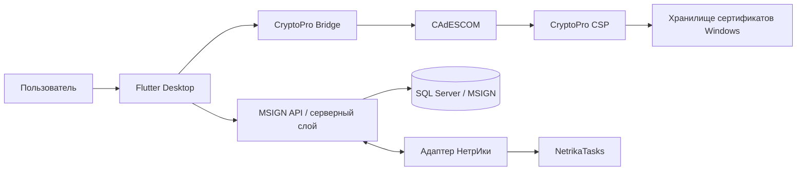
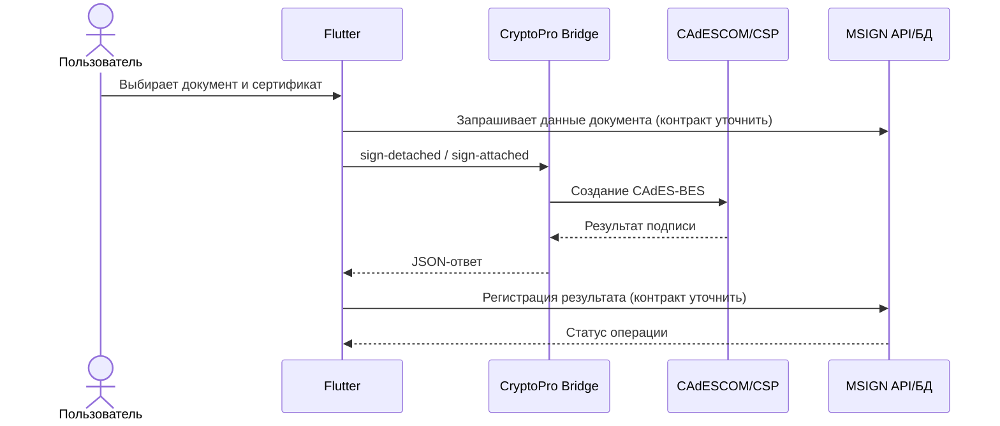

# Архитектура

## Логическая схема

Схема отражает целевое разделение ответственности. Наличие и фактические границы MSIGN API требуют сверки с актуальным серверным кодом.

## Компоненты

### Flutter Desktop
Отвечает за пользовательский интерфейс, отображение документов и сертификатов, запуск пользовательских операций и представление результатов. Не должен напрямую создавать COM-объекты CAdESCOM.

### CryptoPro Bridge
Отдельный Windows x64 процесс на C#/.NET Framework 4.8. Принимает JSON через stdin и возвращает JSON через stdout. Каждый вызов клиента запускает отдельный процесс.

### CAdESCOM и CryptoPro CSP
Выполняют криптографические действия и взаимодействуют с сертификатами/закрытыми ключами через Windows и установленный криптопровайдер.

### SQL Server / MSIGN
Хранит пользователей, сертификаты, документы, подписи, операции, результаты проверок, интеграционные настройки и аудит. Подтверждённые имена таблиц перечислены в [[04-База-данных]].

### НетрИка
Для задач обмена предусмотрены сущности `NetrikaTasks` и `NetrikaTaskDocuments`. Транспорт, формат сообщений, ретраи и правила идемпотентности необходимо подтвердить по интеграционному коду.

## Поток подписания

## Границы безопасности

- Закрытый ключ не передаётся во Flutter и не экспортируется Bridge.
- PIN не должен передаваться в JSON и не должен попадать в журналы.
- Доступ к ключу и PIN-диалог контролируется CSP/носителем.
- Локальный процесс запускается без shell.
- Криптографическая валидность подписи не равна проверке доверия к сертификату.
