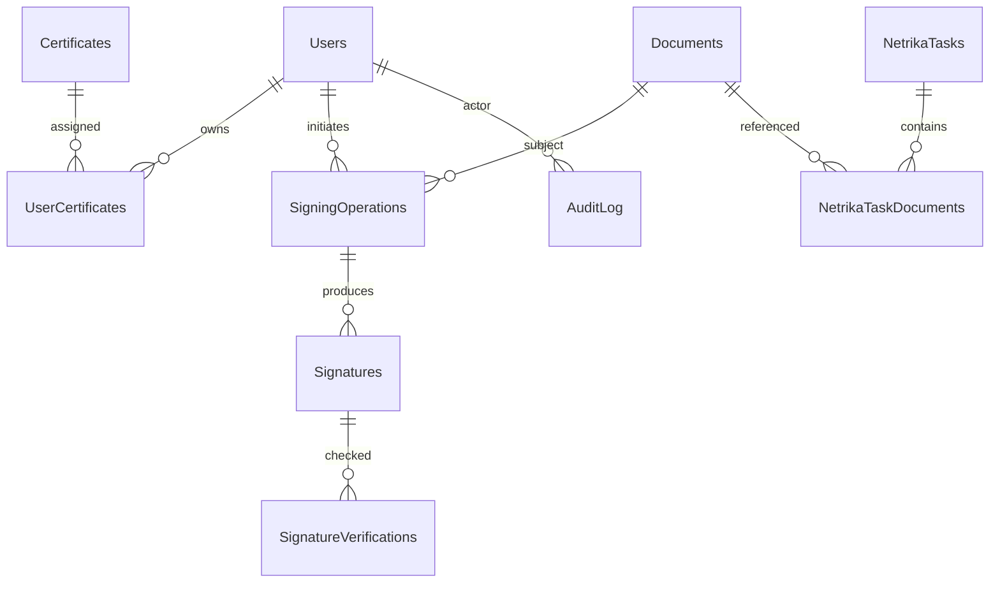

# База данных MSIGN

## Сервер

По предоставленным сведениям используется:

`Microsoft SQL Server 2012 - 11.0.2100.60 (X64)`

Это старая версия SQL Server. При проектировании схемы и запросов необходимо учитывать совместимость с SQL Server 2012, а также отдельно оценить план обновления платформы.

## Подтверждённые таблицы схемы MSIGN

| Таблица | Предполагаемая область ответственности по названию |
|---|---|
| `AuditLog` | Аудит событий |
| `Certificates` | Реестр сертификатов |
| `Documents` | Документы |
| `IntegrationSettings` | Настройки интеграций |
| `NetrikaTaskDocuments` | Связь задач НетрИки с документами |
| `NetrikaTasks` | Задачи интеграции |
| `Signatures` | Подписи |
| `SignatureVerifications` | Результаты проверки подписей |
| `SigningOperations` | Операции подписания |
| `UserCertificates` | Связь пользователей и сертификатов |
| `Users` | Пользователи |

> [!warning] Важное ограничение
> Назначение в таблице выше является предварительной интерпретацией имён. Структура колонок, ключи, индексы, ограничения и связи не были предоставлены в этом источнике. Не использовать её как готовую ER-модель.

## Предлагаемая ER-модель для проверки



Связи на диаграмме гипотетические и должны быть сверены с DDL.

## Что запросить из SQL Server

```sql
-- Колонки и типы
SELECT
    s.name AS schema_name,
    t.name AS table_name,
    c.column_id,
    c.name AS column_name,
    ty.name AS data_type,
    c.max_length,
    c.precision,
    c.scale,
    c.is_nullable
FROM sys.tables t
JOIN sys.schemas s ON s.schema_id = t.schema_id
JOIN sys.columns c ON c.object_id = t.object_id
JOIN sys.types ty ON ty.user_type_id = c.user_type_id
WHERE s.name = N'MSIGN'
ORDER BY t.name, c.column_id;

-- Внешние ключи
SELECT
    fk.name AS foreign_key_name,
    OBJECT_NAME(fkc.parent_object_id) AS parent_table,
    COL_NAME(fkc.parent_object_id, fkc.parent_column_id) AS parent_column,
    OBJECT_NAME(fkc.referenced_object_id) AS referenced_table,
    COL_NAME(fkc.referenced_object_id, fkc.referenced_column_id) AS referenced_column
FROM sys.foreign_key_columns fkc
JOIN sys.foreign_keys fk ON fk.object_id = fkc.constraint_object_id
WHERE SCHEMA_NAME(OBJECTPROPERTY(fkc.parent_object_id, 'SchemaId')) = N'MSIGN'
ORDER BY parent_table, foreign_key_name;
```

Следующий шаг: сохранить полный DDL всех таблиц, индексов, FK, defaults, triggers и процедур в `database/` или приложить SQL-скрипт к репозиторию.
